# LinkPulse

**A URL shortener with real-time click analytics.** You can create branded short links, generate QR codes, and see who clicks: referrers, countries, cities, devices, browsers and operating systems. Bot traffic is filtered out.

**[Live demo](https://linkpulse-lalit.vercel.app)** · demo login `demo@linkpulse.dev` / `demo1234`

LinkPulse is a single full-stack Next.js app. It covers the usual pieces of a SaaS product: authentication, a fast redirect path, analytics queries in Postgres, a REST API with hashed keys and rate limiting, tests that run against a real database, Docker, and CI.

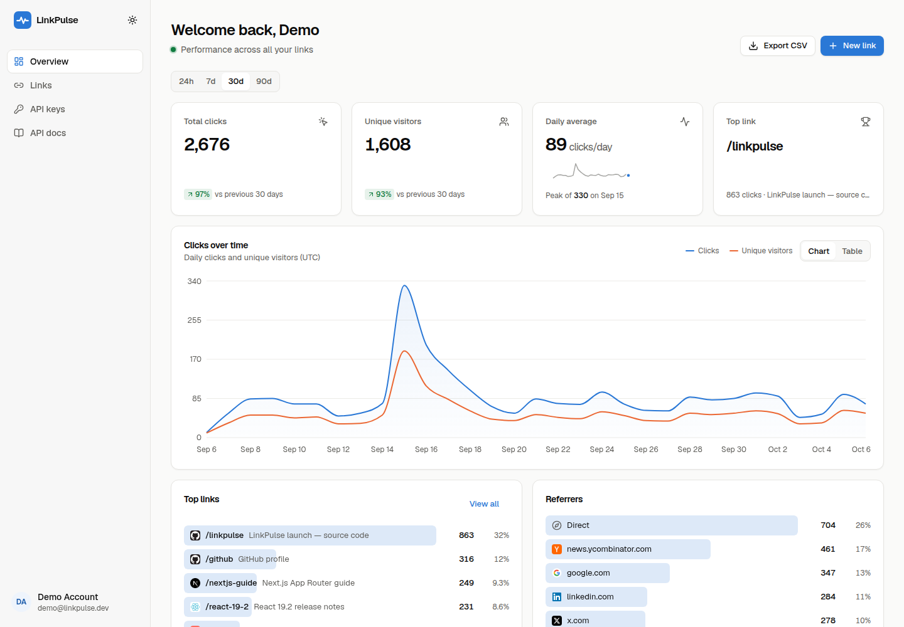

> **Try it:** on the landing page, click **"Try the demo account"**. You'll be signed into a workspace with 15 links and about 5,000 clicks spread over the last 90 days. No sign-up is needed.

---

## Contents

- [Features](#features)
- [Screenshots](#screenshots)
- [Tech stack](#tech-stack)
- [Architecture](#architecture)
- [Data model](#data-model)
- [Local setup](#local-setup)
- [Environment variables](#environment-variables)
- [Deploying (Neon + Vercel)](#deploying-neon--vercel)
- [REST API](#rest-api)
- [Testing](#testing)
- [Project structure](#project-structure)
- [Design decisions](#design-decisions)
- [License](#license)

## Features

**Links**

- Short links with an auto-generated slug (7 characters, chosen from an alphabet without look-alike characters) or a custom alias, with a live availability check
- Optional title, tags, expiry date, password protection, and a **UTM builder** that previews the final URL
- Edit, disable/enable, duplicate, or delete a link
- A **QR code** for every link, in four colours, downloadable as PNG (1024 px) or SVG
- A links table built with TanStack Table. Search, sorting, tag/status filters and pagination all run on the server.

**Analytics**

- Overview KPIs: total clicks and unique visitors (each with change vs. the previous period), daily average with a trend sparkline, and the top link
- A clicks-over-time chart (clicks and unique visitors) with **24h / 7d / 30d / 90d** ranges. Buckets are hourly or daily, and a table view is available as an accessible alternative to the chart.
- Breakdowns by referrer, country, city, device, browser and OS
- A per-link analytics page with a **live "recent clicks" feed**. Data refreshes automatically every 10–15 seconds.
- **CSV export**, streamed from the database in batches. Fields are escaped to prevent formula injection.

**Redirects and tracking**

- `/{slug}` does a single indexed lookup and returns a `302`. The click is recorded **after the response is sent**, using Next.js `after()`.
- Each click stores the timestamp, referrer domain, country/region/city (from Vercel geo headers, falling back to `Unknown`), device, browser and OS (parsed with `ua-parser-js`).
- **Bot detection** (`isbot` plus extra patterns) keeps crawlers, link unfurlers, headless browsers and `curl` out of the stats. The redirect itself still happens for them.
- Visitors are identified privately: the visitor ID is a salted SHA-256 of IP + user agent that **rotates daily**. Raw IP addresses are never stored.
- Polished pages for password-protected, expired, disabled and unknown links. Unknown links return a real `404`.

**Platform**

- Email + password auth (bcrypt). Sessions are signed JWTs (`jose`) stored in an `httpOnly` cookie. `proxy.ts` (the Next 16 replacement for middleware) guards `/dashboard`, and every data access is authorised again on the server.
- **"Try the demo"** one-click login. **GitHub OAuth** is optional and switches on when its env vars are set.
- **Developer API** (`/api/v1/links`). API keys are SHA-256 hashed at rest and shown once. Requests are rate limited per key and the API docs page lives inside the app.
- **Rate limiting** behind a small store interface. There is a Postgres store (one atomic UPSERT, so it works across serverless instances) and an in-memory store. It covers login, sign-up, link creation, alias checks, password unlocks and the API.
- A daily **Vercel Cron** job restores the shared demo account and prunes expired rate-limit windows.
- Responsive and accessible UI with dark/light/system themes, skeleton loading states, empty and error states, and toasts.

## Screenshots

| Landing (light)                                      | Landing (dark)                                     |
| ---------------------------------------------------- | -------------------------------------------------- |
| 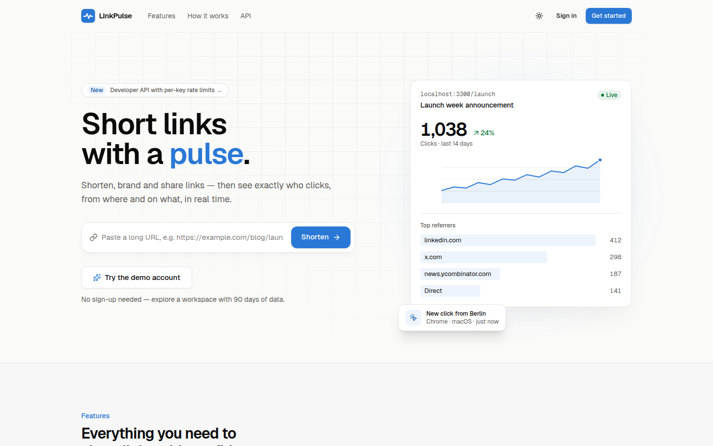 | 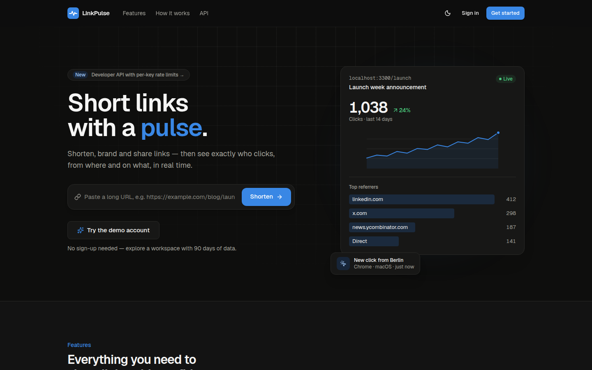 |

| Dashboard (dark)                                       | Per-link analytics (dark)                                   |
| ------------------------------------------------------ | ----------------------------------------------------------- |
| 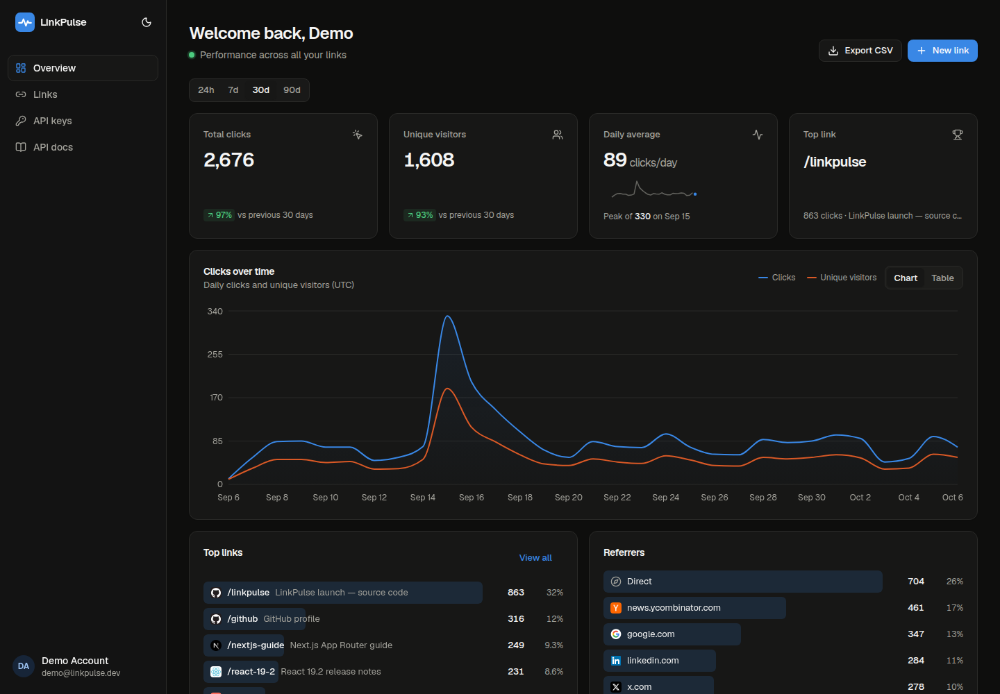 | 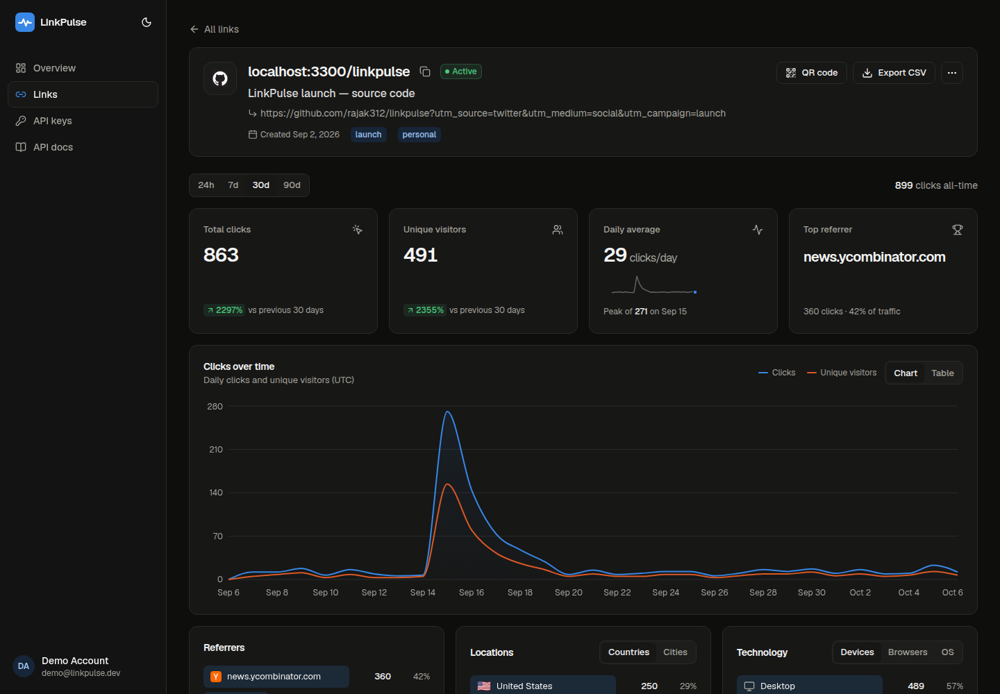 |

| Links table                                | Create link (alias check + UTM builder)                |
| ------------------------------------------ | ------------------------------------------------------ |
| 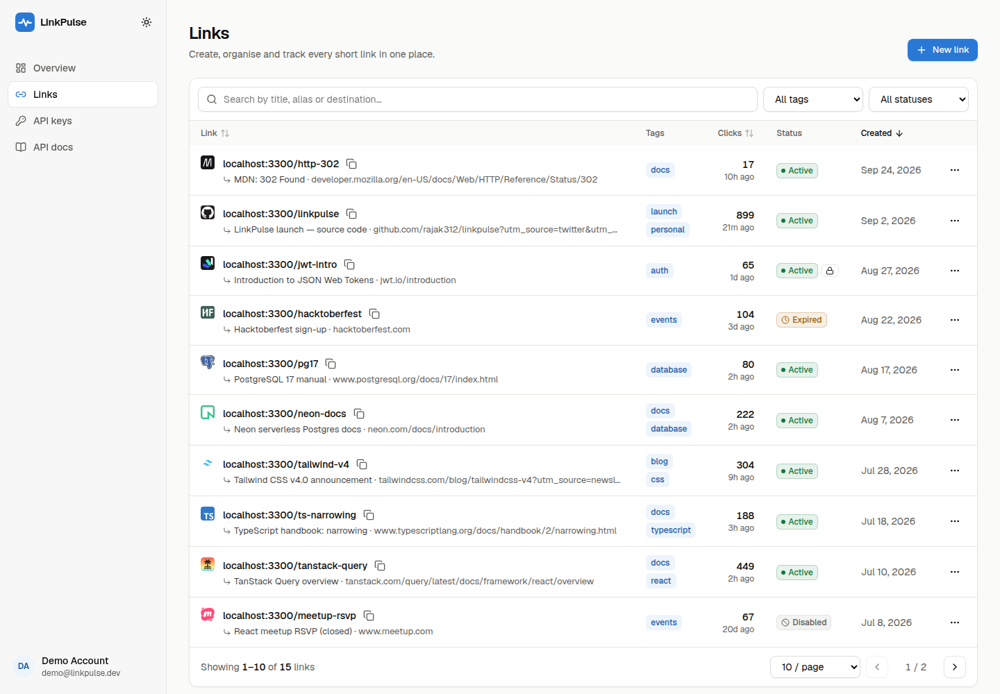 | 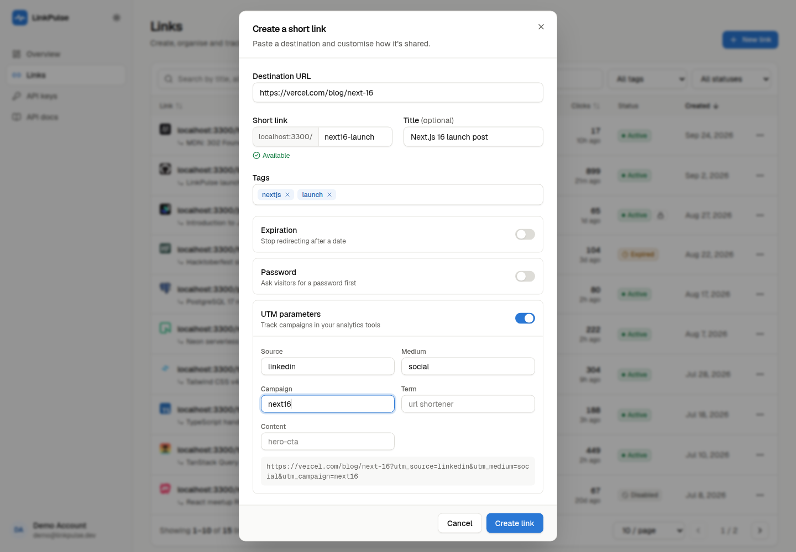 |

| QR code                                  | API keys                                         | API docs                                     |
| ---------------------------------------- | ------------------------------------------------ | -------------------------------------------- |
| 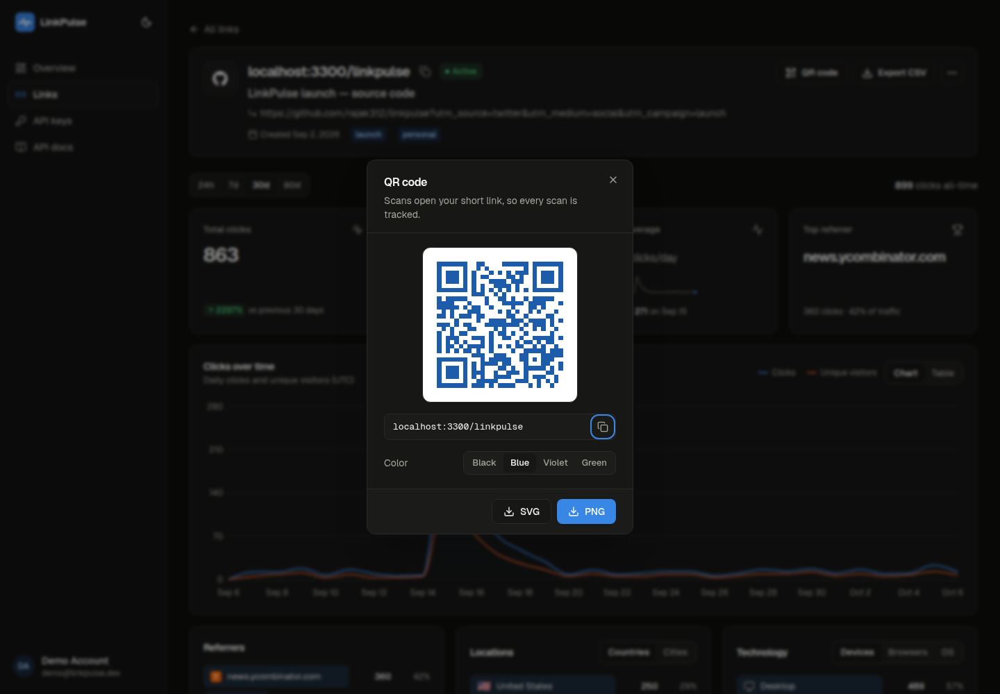 | 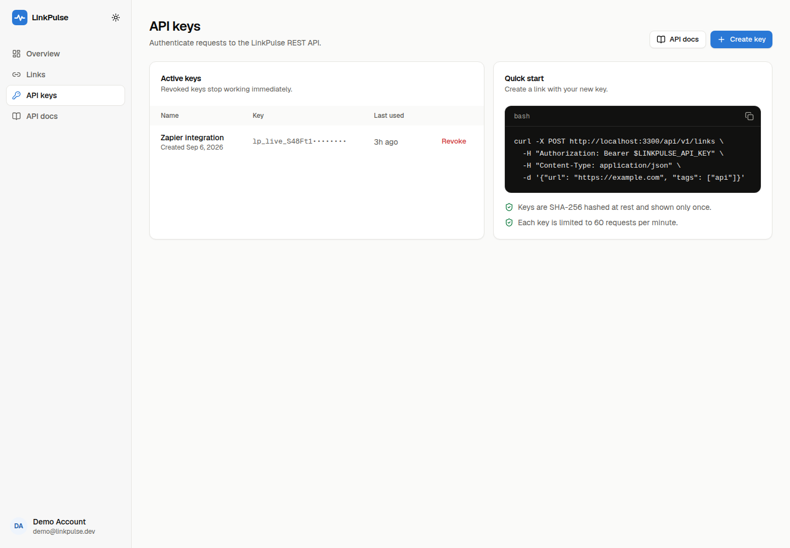 | 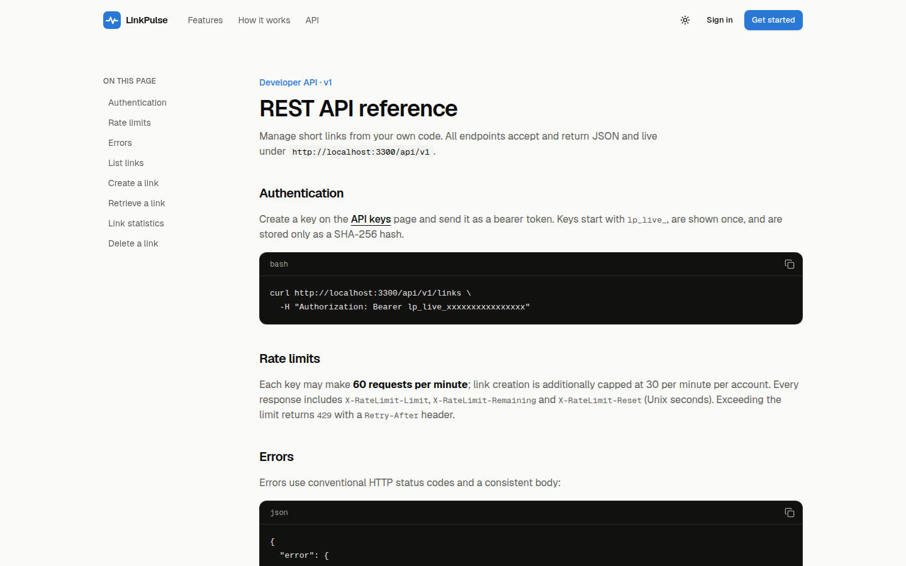 |

| Mobile dashboard                                                   | Mobile links                                                   | Password-protected link                                    |
| ------------------------------------------------------------------ | -------------------------------------------------------------- | ---------------------------------------------------------- |
| 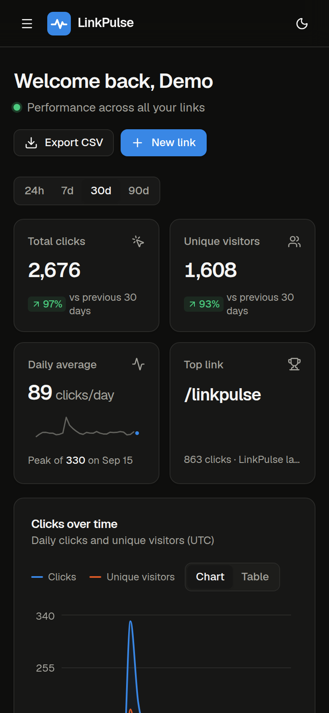 | 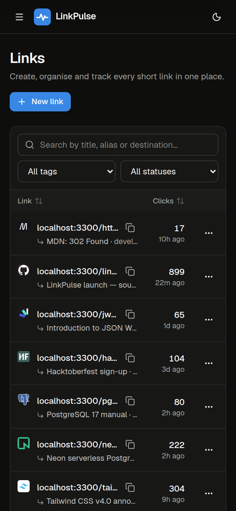 | 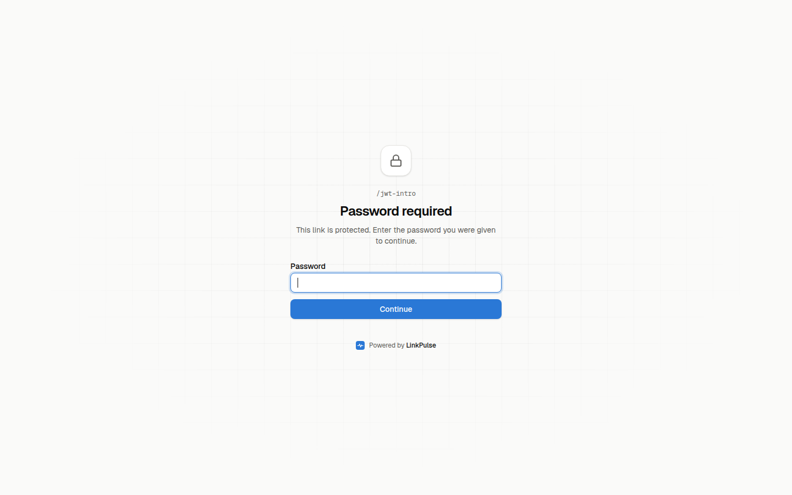 |

## Tech stack

| Area        | Choice                                                                                              |
| ----------- | --------------------------------------------------------------------------------------------------- |
| Framework   | **Next.js 16** (App Router, route handlers, server actions, `proxy.ts`, `after()`) and **React 19** |
| Language    | **TypeScript 5** (strict)                                                                           |
| Styling     | **Tailwind CSS v4**, Radix primitives (dialog, dropdown, switch, tooltip), lucide icons             |
| Data        | **PostgreSQL 17** and **Prisma 7** (`prisma-client` generator + `@prisma/adapter-pg`)               |
| Client data | **TanStack Query v5** and **TanStack Table v9**                                                     |
| Charts      | **Recharts 3**                                                                                      |
| Validation  | **zod 4** (shared by the client, server actions and the REST API)                                   |
| Auth        | `bcryptjs`, `jose` (HS256 JWT in an httpOnly cookie), optional GitHub OAuth                         |
| Tracking    | `ua-parser-js` (MIT, v1), `isbot`, Vercel geo headers                                               |
| Testing     | **Vitest** (unit tests plus integration tests against a real Postgres)                              |
| Tooling     | ESLint 9 (flat config), Prettier (+ Tailwind plugin), GitHub Actions, Docker                        |

## Architecture

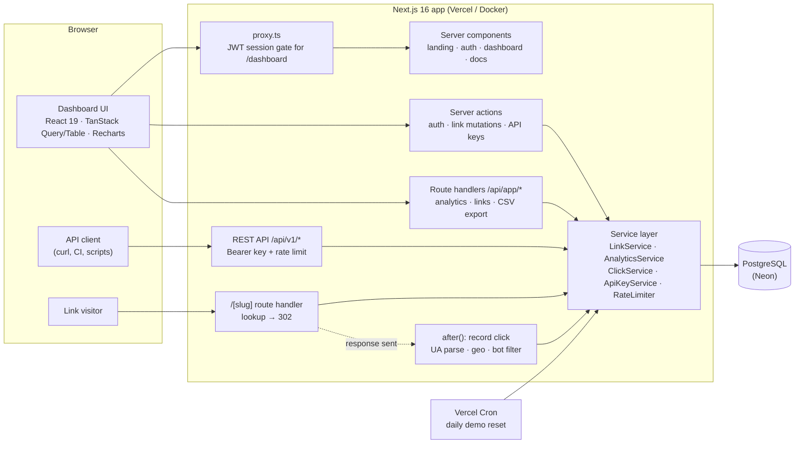

**Request paths**

- **Redirect (hot path):** `GET /{slug}` → one `findUnique` on the unique `slug` index → `302 Location: <destination>`. Anything that needs a human (a password, expired, disabled, or unknown link) is sent to `/l/{slug}`, which renders the right page. Click recording runs in `after()`, so the database writes never add latency to the redirect.
- **Dashboard reads:** TanStack Query calls the session-authenticated route handlers under `/api/app/*`. Analytics refresh on an interval, so new clicks appear without a page reload.
- **Mutations:** server actions validate input with the same zod schemas the REST API uses. They return a typed `ActionResult`, and the client then invalidates the affected queries.
- **Public API:** `/api/v1/*` authenticates with a Bearer key (looked up by its SHA-256 hash) and applies per-key rate limits. It calls the same services as the UI.

## Data model

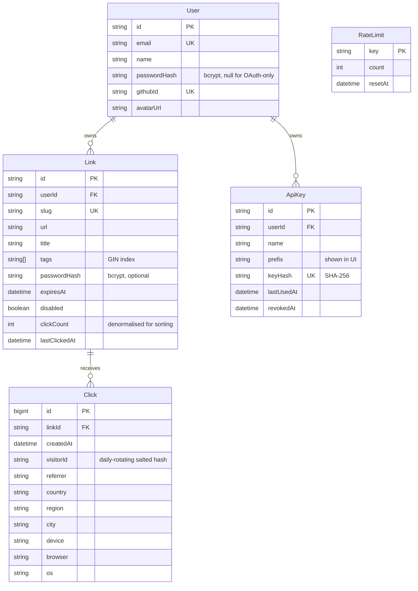

Indexes: `Click(linkId, createdAt)` and `Click(createdAt)` for the range queries, `Link(userId, createdAt desc)` for listing, and a GIN index on `Link.tags`. Analytics run as a few parallel aggregate SQL queries (`date_trunc` buckets, `count(DISTINCT visitorId)`, `FILTER` clauses for the previous period). Gaps in the time series are filled on the server, so the chart never interpolates across days with no clicks.

## Local setup

**Requirements:** Node.js ≥ 20.9 (developed on Node 24), npm, and Docker (for Postgres).

```bash
# 1. Install dependencies (postinstall runs `prisma generate`)
npm install

# 2. Start Postgres and create a separate database for integration tests
docker run -d --name linkpulse-db -e POSTGRES_PASSWORD=postgres -e POSTGRES_DB=linkpulse \
  -p 5434:5432 postgres:17-alpine
docker exec linkpulse-db psql -U postgres -c "CREATE DATABASE linkpulse_test;"

# 3. Configure the environment
cp .env.example .env          # defaults already point at the container above

# 4. Create the schema and seed the demo account
npm run db:migrate
npm run db:seed               # demo@linkpulse.dev / demo1234

# 5. Run the app
npm run dev                   # http://localhost:3300
```

### Scripts

| Script                            | What it does                                                               |
| --------------------------------- | -------------------------------------------------------------------------- |
| `npm run dev`                     | Development server on port 3300                                            |
| `npm run build` / `start`         | `prisma generate` + production build / start the production server on 3300 |
| `npm run lint`                    | ESLint                                                                     |
| `npm run format` / `format:check` | Prettier                                                                   |
| `npm run typecheck`               | `next typegen` + `tsc --noEmit`                                            |
| `npm test`                        | Unit and integration tests (Vitest)                                        |
| `npm run test:unit`               | Unit tests only (no database needed)                                       |
| `npm run db:migrate`              | Apply committed migrations (`prisma migrate deploy`)                       |
| `npm run db:migrate:dev`          | Create a new migration while developing                                    |
| `npm run db:seed`                 | (Re)create the demo account and its data (idempotent)                      |

### Docker

The multi-stage `Dockerfile` builds a minimal image from Next.js `standalone` output. It runs as a non-root user and includes a health check. `docker-compose.yml` starts Postgres, runs a one-off job that migrates and seeds the database, and then starts the app:

```bash
docker compose up --build     # http://localhost:3300 (override with APP_PORT=…)
```

## Environment variables

| Variable               | Required | Description                                                                                                                                  |
| ---------------------- | -------- | -------------------------------------------------------------------------------------------------------------------------------------------- |
| `DATABASE_URL`         | ✅       | Postgres connection string. On Neon, use the **pooled** URL (`-pooler` host).                                                                |
| `AUTH_SECRET`          | ✅       | At least 32 random characters, used to sign session cookies. Generate with `openssl rand -base64 32`.                                        |
| `APP_URL`              | ✅\*     | Public base URL for short links, e.g. `https://linkpulse.vercel.app`. \*On Vercel it falls back to `https://$VERCEL_PROJECT_PRODUCTION_URL`. |
| `DIRECT_URL`           |          | Direct (non-pooled) URL used by `prisma migrate`. Recommended with Neon.                                                                     |
| `GITHUB_CLIENT_ID`     |          | Turns on "Continue with GitHub" when set together with the secret below.                                                                     |
| `GITHUB_CLIENT_SECRET` |          | GitHub OAuth app secret. Callback URL: `$APP_URL/api/auth/github/callback`.                                                                  |
| `CRON_SECRET`          |          | Protects `/api/cron/reset-demo`. Vercel Cron sends it automatically as a Bearer token.                                                       |
| `RATE_LIMIT_STORE`     |          | `postgres` (default) or `memory`.                                                                                                            |

Variables are validated with zod when the server starts (`src/instrumentation.ts`), so a misconfiguration fails immediately with a clear message.

## Deploying (Neon + Vercel)

1. **Create the database on Neon**
   - Create a project at [neon.com](https://neon.com) (Postgres 17).
   - From **Connection Details**, copy two strings:
     - the **pooled** connection string → `DATABASE_URL`
     - the **direct** connection string (untick "Connection pooling") → `DIRECT_URL`
   - Both should end with `?sslmode=require`.

2. **Run migrations and seed the demo account** from your machine:

   ```bash
   DATABASE_URL="<pooled url>" DIRECT_URL="<direct url>" npm run db:migrate
   DATABASE_URL="<pooled url>" npm run db:seed
   ```

3. **Import the repo into Vercel**
   - Go to **Add New → Project**, pick the GitHub repo, and keep the framework preset **Next.js**. The build command `npm run build` already runs `prisma generate`.
   - Add these environment variables (Production and Preview): `DATABASE_URL`, `DIRECT_URL`, `AUTH_SECRET`, `APP_URL` (your production domain), and `CRON_SECRET` (any long random string). Add `GITHUB_CLIENT_ID` / `GITHUB_CLIENT_SECRET` only if you want GitHub login.
   - Deploy.

4. **After deploying**
   - Open `https://<your-domain>/api/health`. It should return `{"status":"ok"}`.
   - `vercel.json` registers a daily cron job (`/api/cron/reset-demo`, 04:00 UTC) that restores the demo account. Vercel sends `CRON_SECRET` with each call automatically.
   - Later schema changes: run `npm run db:migrate` against Neon (with `DIRECT_URL`) before or right after deploying. You could also add `prisma migrate deploy` to the build command if you prefer deploy-time migrations.
   - Optional: add a custom domain and update `APP_URL` to match.

## REST API

Full reference: **`/docs`** in the running app. Create a key under **Dashboard → API keys**.

```bash
export LINKPULSE_API_KEY="lp_live_…"
export BASE="http://localhost:3300/api/v1"

# Create a link (custom alias, tags, UTM-tagged destination)
curl -X POST "$BASE/links" \
  -H "Authorization: Bearer $LINKPULSE_API_KEY" \
  -H "Content-Type: application/json" \
  -d '{"url":"https://example.com/launch?utm_source=api","slug":"launch","title":"Launch","tags":["marketing"]}'

# List links (search, filters, sorting, pagination)
curl "$BASE/links?q=launch&status=active&sort=clickCount&order=desc&page=1&pageSize=20" \
  -H "Authorization: Bearer $LINKPULSE_API_KEY"

# Get one link
curl "$BASE/links/<id>" -H "Authorization: Bearer $LINKPULSE_API_KEY"

# Aggregated analytics for a link (24h | 7d | 30d | 90d)
curl "$BASE/links/<id>/stats?range=7d" -H "Authorization: Bearer $LINKPULSE_API_KEY"

# Delete
curl -X DELETE "$BASE/links/<id>" -H "Authorization: Bearer $LINKPULSE_API_KEY"
```

Every response carries `X-RateLimit-Limit`, `X-RateLimit-Remaining` and `X-RateLimit-Reset`. Errors share one shape, `{ "error": { "code", "message", "fields?" } }`, with the status codes `400 invalid_json`, `401 unauthorized`, `404 not_found`, `409 conflict`, `422 validation_error` and `429 rate_limited` (which includes `Retry-After`).

## Testing

```bash
npm test                  # 95 tests: unit + integration
npm run test:unit         # unit only, no database required
npm run test:integration  # needs Postgres (uses .env.test → linkpulse_test)
```

- **Unit tests:** slug generation and validation, the UTM builder, user-agent parsing, bot detection, the rate limiter (with a fake clock), referrer/geo/visitor hashing, session tokens, API key helpers, zod schemas, CSV escaping, safe redirects, and time-series gap filling.
- **Integration tests** run against a **real Postgres database**. A global setup applies the migrations, and each test truncates the tables. They cover:
  - the link service: CRUD, conflicts, search/filter/sort/pagination, ownership checks, partial updates, duplication
  - click recording and analytics aggregation: totals, previous period, buckets, breakdowns, tenant isolation
  - CSV export batching
  - API keys: hashing, authentication, revocation
  - the Postgres rate limiter, including concurrent requests and window reset
  - the idempotent demo seed
  - the `/api/v1` **route handlers**, invoked directly with `Request` objects: auth, the full lifecycle, error formats, and rate limiting

  As a safety guard, the integration suite refuses to run unless the database name contains `test`.

CI (`.github/workflows/ci.yml`) runs lint, a formatting check, typecheck, migrations, every test, and a production build against a Postgres 17 service container.

## Project structure

```
prisma/
  schema.prisma            # data model
  migrations/              # committed SQL migrations
  seed.ts                  # demo account seed (uses src/server/services/demo-seed.ts)
src/
  proxy.ts                 # auth gate for /dashboard (Next 16 "proxy", formerly middleware)
  instrumentation.ts       # env validation at startup
  app/
    (marketing)/           # landing page, API docs
    (auth)/                # login, sign-up, server actions
    dashboard/             # overview, links, link analytics, API keys
    [slug]/route.ts        # redirect hot path
    l/[slug]/              # password / expired / disabled pages
    api/app/*              # session-authenticated JSON + CSV endpoints
    api/v1/*               # public REST API
    api/cron/reset-demo    # daily maintenance
  components/              # UI primitives (ui/) and dashboard components
  lib/                     # auth, validation, slug, utm, user-agent, rate-limit, …
  server/
    services/              # LinkService, AnalyticsService, ClickService, ApiKeyService, demo seed
    http.ts, api-auth.ts   # error mapping + API key auth for route handlers
tests/
  unit/                    # pure logic
  integration/             # services + route handlers against Postgres
```

## Design decisions

- **Redirect speed over synchronous tracking.** Recording the click in `after()` keeps the redirect to a single indexed read. The trade-off: if the process dies at exactly the wrong moment, one click can be lost.
- **Denormalised `clickCount`.** Sorting the links table by clicks doesn't need an aggregate. The counter and the click row are written in the same transaction.
- **A Postgres rate limiter instead of Redis.** Serverless instances share no memory, so the limiter does one atomic `INSERT … ON CONFLICT DO UPDATE` per check. That avoids adding another piece of infrastructure, and a Redis/Upstash store can be added behind the same `RateLimitStore` interface.
- **Privacy-friendly unique visitors.** No raw IPs and no cookies on visitors. Because the visitor hash rotates daily, "unique visitors" over a multi-day range means unique visitor-days (the same approach privacy-focused analytics tools use).
- **"Click trend" instead of CTR.** A shortener can't see impressions, so it can't compute a true click-through rate. The dashboard shows the period-over-period change, a daily average with a sparkline, and the peak day instead.
- **Licences.** `ua-parser-js` v2 is AGPL-3.0, so the project pins the MIT-licensed v1 to stay MIT-compatible.
- **Charts.** Two validated, colour-blind-safe series colours (checked separately for light and dark), a single y-axis, a crosshair tooltip, and a table view as an accessible alternative.

## License

[MIT](LICENSE) © 2026 [Lalit Kumar Rajak](https://github.com/lalitkumarrajak)
